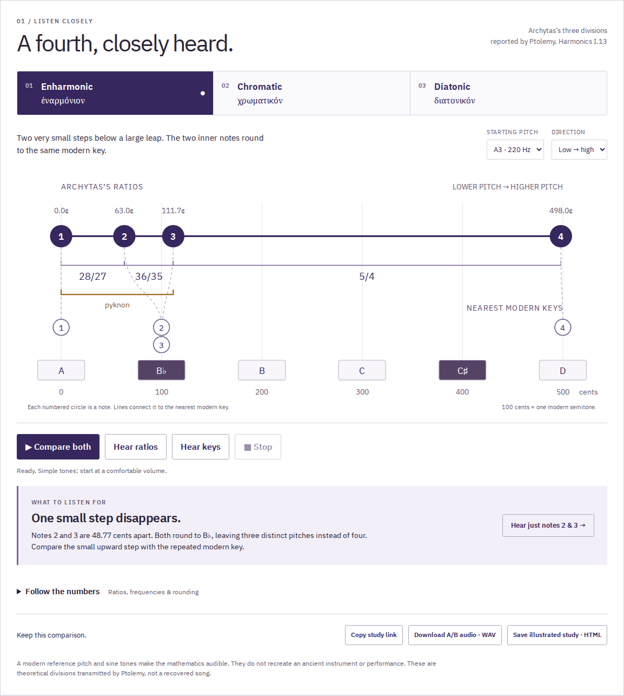
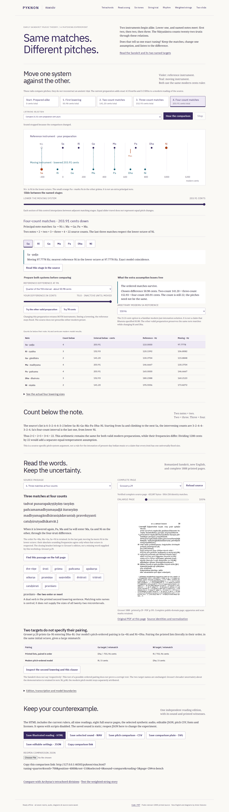
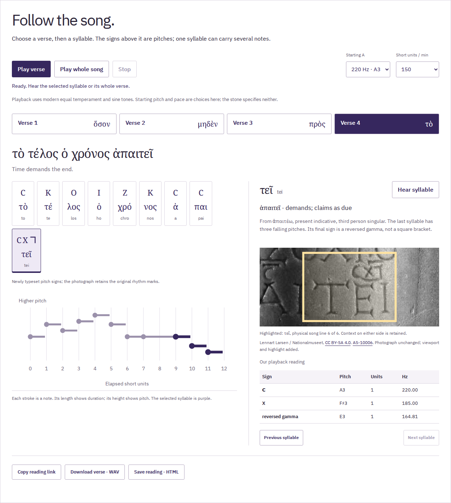
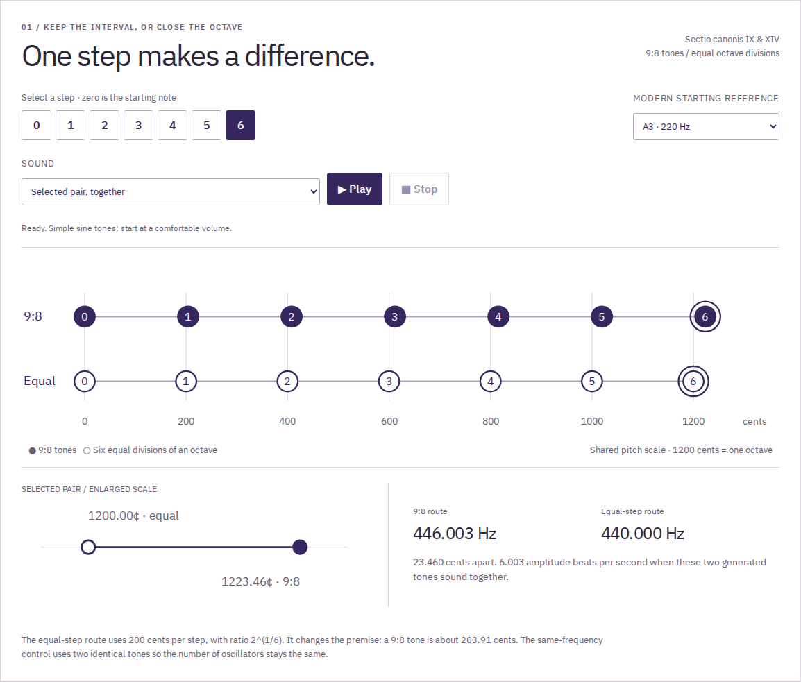
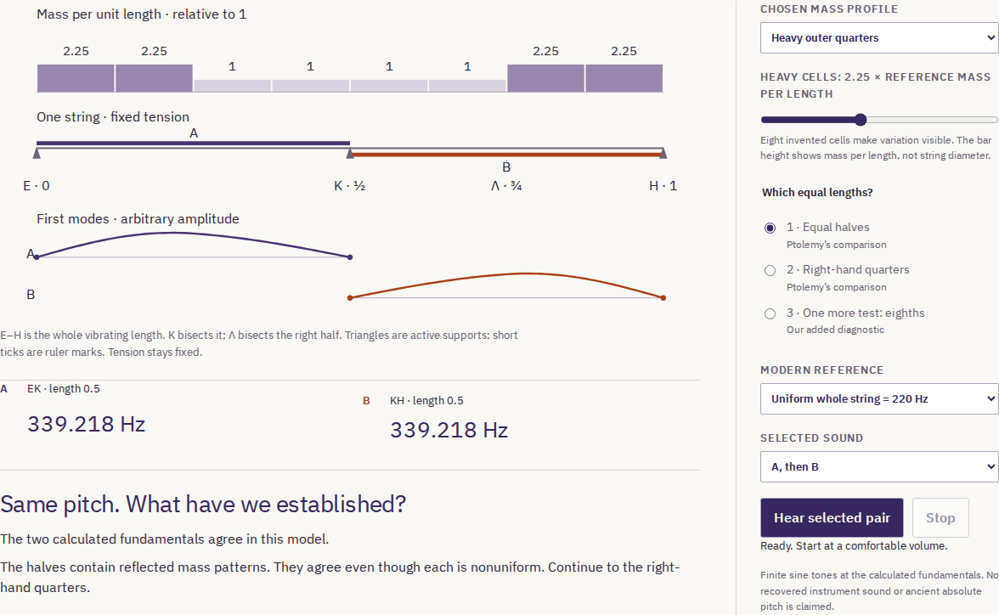
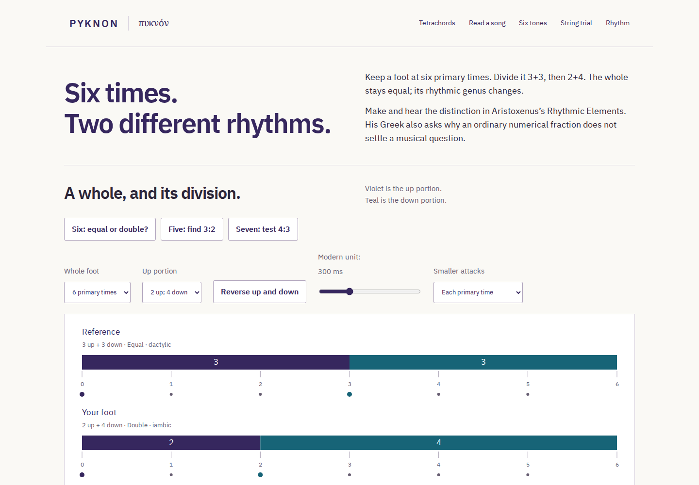
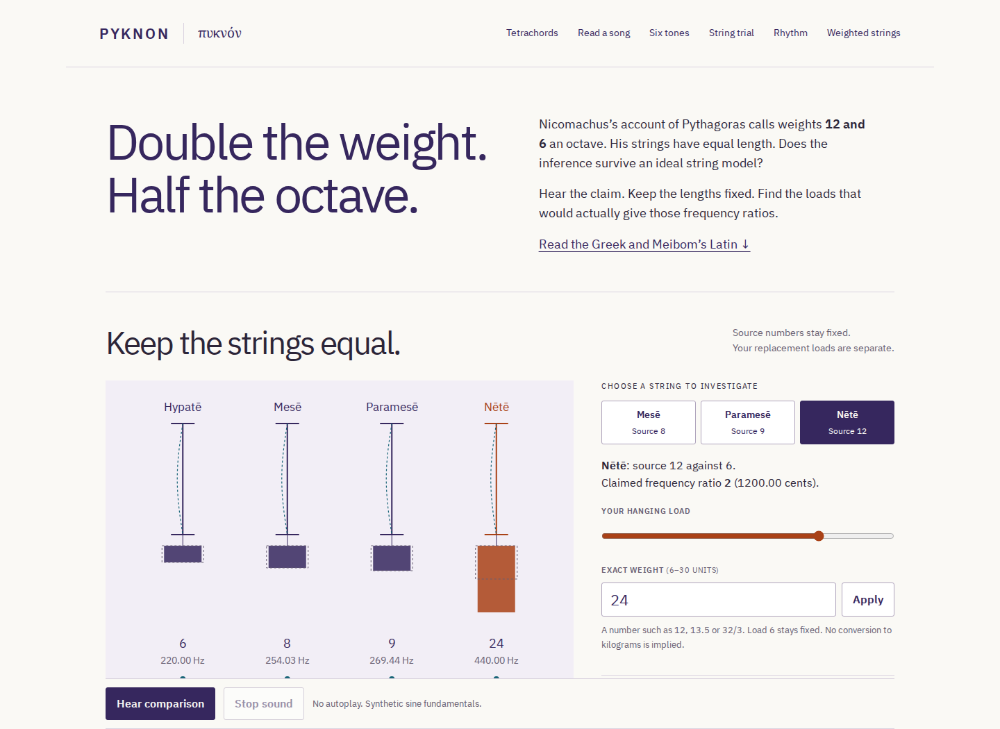

# Pyknon

**Hear the ancient interval that disappears between modern piano keys.**

Archytas's enharmonic tetrachord places two notes about 49 cents apart. Round
both to the nearest modern key and the interval vanishes. Pyknon makes that
loss audible, visible and traceable to a source: Ptolemy's report of Archytas,
with Greek and Latin pages from a 1682 edition.

[Open the listening workbench](https://antonsoo.github.io/pyknon/?g=enharmonic&a=220&d=up#listen)
· [MIT license](LICENSE)
· [Source and model](docs/model.md)



## Try it

1. Press **Compare both**: four ratio-based tones, a pause, four rounded tones.
2. Press **Hear just notes 2 & 3**. The small step becomes a repeated key.
3. Switch to **Chromatic** and **Diatonic**. In this particular scheme, only the
   third pitch moves. Watch when the close-packed group—the _pyknon_—disappears.

Three modern A references and either playback direction are available. Open
**Follow the numbers** for frequencies, cumulative ratios, cents and rounding
errors; each original note can be played separately. Greek vocabulary points
back to the experiment. The source panel includes a short Latin sentence with
a new English translation and the actual scanned pages.

**Download A/B audio** saves the generated WAV. **Save illustrated study** saves
an HTML document with the diagram, measurements and citations; it opens offline
and can be printed. Shared URLs preserve genus, reference pitch and direction.
The published app works offline once its footer confirms the complete edition
has been saved, including all three source scans. No account or external font
service is used.

## Keep the matches; change the tuning

Open the **[two-vīṇā room](https://antonsoo.github.io/pyknon/vina.html?tuning=comma&tenth=215&position=2000&root=220&selected=2&sound=pair&reading=3&page=29#vn-bench)**, also reached through **Two vinas** in every room's navigation.

In the two-vīṇā demonstration in _Nāṭyaśāstra_ 28, named notes meet after
successive lowerings. Two notes receive two counts, two receive three, and
three receive four: 2×2 + 2×3 + 3×4 = 22. Does that determine one exact tuning?

Our explicit modern model follows Bernard Bel's algebraic reading and adds
pure fourths and fifths. At the second stage, Ga meets Ri. Change the
preparation from a 21.51-cent reference difference to 50.98 cents: the same
match survives, but at a modern Sa of 220 Hz it moves from **244.4444 Hz to
240.3184 Hz**. Hear both preparations. At the upper boundary, the second and
third stages merge; beyond it, the nominal third lowering would raise pitch.
The source does not prescribe either preset or all twenty-two frequencies.

Read nine passages in the edition's romanized Sanskrit and new English,
twelve contextual word notes, and eight complete 1888 printed pages. The
source lists two targets without saying “respectively”; a test of one ordered
pairing is kept distinct from a claim that the text is corrupt.

Save the current sound, rulers, all readings and source pages, editable JSON,
pitch CSV, fonts and licenses in one script-free HTML reading. It opens as a
file, plays its embedded synthetic sound and prints without the site. Native
WAV, CSV, JSON and a font-embedded SVG are available separately. All seven
rooms belong to one integrity-checked offline edition.



[Source and derivation](docs/vina-model.md) · [Direct review](docs/vina-review.md) ·
[Saved reading, gzip](examples/two-vinas-reading.html.gz) ·
[Fifteen-page PDF](examples/two-vinas-reading.pdf) ·
[Editable JSON](examples/two-vinas-comparison.json) ·
[Modern listening WAV](examples/two-vinas-modern-comparison.wav).
Decompress the HTML to open the complete independent reading. The app saves it directly as HTML.

The related [Grāma bench](https://antonsoo.github.io/grama/) teaches a different
operation: changing the starting note or lowering Pa alone while the other
six notes stay fixed. This room follows the longer two-instrument matching
argument and its remaining numerical freedom.

## Read a surviving song

Open the **[Seikilos song reader](https://antonsoo.github.io/pyknon/song.html?s=3&a=220&pace=150#reader)**.
Its source, build and hosted verification are recorded separately in
[the reading review](docs/seikilos-review.md).

Select a Greek syllable to locate it in the museum's photograph and hear its
notes. The first syllable of **φαίνου** carries three rising notes; the last
syllable of **ἀπαιτεῖ** ends with a reversed gamma whose early misreading changed
the melody's ending. The source images and the historical correction are
included, with photographer credits and licenses.


- Read four complete verses, with 29 syllables, 37 notes and English word notes.
- Hear one syllable, its verse or the full song. Follow notes across physical
  line breaks without moving keyboard focus.
- Choose a modern pitch reference and pace. Playback uses equal temperament
  and sine tones; it does not infer an ancient tuning or instrument.
- Save a verse as WAV, or save an HTML reading with the photograph embedded,
  all verses and their pitch tables. Both app pages work offline once saved.

The Greek text is normalized; the image shows the surviving lettering.
The duration reading follows Armand D'Angour's modern transcription. Monro's
1894 correction supplies evidence for the final pitch sign, with its different
rhythm explicitly identified. [Sources and image licenses](THIRD_PARTY.md).

## Can six whole tones fill an octave?

The new **Six tones** room follows a numerical proof in the _Sectio canonis_,
transmitted under Euclid's name. Six 9:8 tones reach 1223.460 cents. Six modern
200-cent steps reach exactly 1200. The small difference is audible.

[Open the listening lesson](https://antonsoo.github.io/pyknon/canon.html?n=6&a=220&sound=beat#canon).
Select a step from zero to six. Both pitch routes, the enlarged detail,
frequencies and original integer progression stay connected. Hear each pair
successively, sound it together, climb both routes, or compare the beating
with two identical tones. At the 220 Hz reference, the final pair is
440 Hz and 446.003 Hz.

Read the complete short proof in Greek, Menge's Latin and a new English
translation. Four word notes explain its musical ratios and comparisons.
Six complete 1916 edition pages cover the integer proof and its musical
premises; the source numbers were checked visually against the print.
Save the selected sound as WAV, the numbers as CSV, or an illustrated HTML
reading with all source pages and the Greek font embedded.

[Saved illustrated reading](examples/canon-six-tones-reading.html) ·
[Ten-page printable PDF](examples/canon-six-tones-reading.pdf) ·
[Beating pair](examples/canon-220-beating.wav) ·
[Identical-tone control](examples/canon-220-control.wav).



This is a modern listening realization of a ratio proof. Equal octave
divisions, cents and acoustic beating are explanatory comparisons, without
a claim about ancient performance. The [source and design decisions](docs/canon-design.md)
and [review record](docs/canon-review.md) describe the boundaries and evidence.

## Can you trust the string behind the ruler?

The **[String trial](https://antonsoo.github.io/pyknon/trial.html)** reads Ptolemy’s
_Harmonics_ I.8. Before using a monochord’s divisions, he compares equal halves
of its string, then two equal quarters. If the required agreement fails, move
the examination to another part or another string.

The first guided example passes the halves test and fails the quarters. A
repeating mass pattern passes both, then fails an extra eighths test. You can
hear each pair, change the mass contrast, inspect the calculated first modes,
and compare all three measurements. The extra test and stepwise mass patterns
are explicit modern experiments. Agreement at these divisions does not prove
arbitrary material uniformity.

| Chosen mass profile  | Halves agree | Right quarters agree | Extra eighths agree |
| -------------------- | ------------ | -------------------- | ------------------- |
| Uniform              | Yes          | Yes                  | Yes                 |
| Heavy outer quarters | Yes          | No                   | Yes                 |
| Repeating variation  | Yes          | Yes                  | No                  |
| Heavy left half      | No           | Yes                  | Yes                 |



This table uses the selected heavy density 2.25 times the reference. The
nonuniform model follows the mass distribution through every cell; it does
not substitute an average into the uniform-string formula. An independent
grid eigenvalue calculation checks the application’s exact cell solutions.

Read six short Greek / Wallis Latin / new English excerpts, with grammar notes
and three reading questions. Inspect six full 1682 pages, zoom and pan by
keyboard, including Wallis’s discussion of his changed bridge diagram. Save
a single HTML packet with the Greek font, all scans, playable selected WAV,
measurements and diagram. Its embedded CSV, WAV and SVG downloads work from disk.
The shared URL preserves the experiment and reading.

[Saved reading with audio](examples/string-trial-reading.html) ·
[Eleven-page PDF](examples/string-trial-reading.pdf) ·
[Source and derivation](docs/trial-model.md) · [Review](docs/trial-review.md).
The ideal model holds tension fixed while adding exact supports. It does not
model bridge-induced stretching, real gut manufacture or ancient performance.

## Six times, two rhythmic genera

The new [rhythm room](https://antonsoo.github.io/pyknon/rhythm.html) lets a foot stay at six primary times while
you change its division from 3+3 to 2+4. The total stays fixed; its genus
changes from equal/dactylic to double/iambic. Reverse the up/down assignments,
or join the smaller attacks while preserving the defining division. Explore
five and seven too, with the scope of Aristoxenus's three admitted genera explicit.



A second experiment keeps the down portion at two times and varies the up
portion between one and two. Our illustrative 1½ gives up:down = 3:4, an
ordinary rational fraction. Read why the source's _alogos_ involves a
rhythmically admissible common measure, rather than arithmetic alone. The
source does not prescribe our exact midpoint.

Ten Greek excerpts, new English, thirty-seven contextual word notes, one
separately attributed Latin parallel and eight complete 1861 source pages
accompany the two experiments. The fragment's final 'because …' remains a
break; the later parallels printed on the same pages remain distinct.

Save native JSON, SVG, scheduled-onset CSV or synthetic WAV. A single
script-free HTML reading keeps both experiments, all readings and source
images, font, editable JSON and the selected sound. The whole seven-room edition
works offline after complete installation. Sine clicks mark positions; their
short decays do not represent sung note lengths or reconstruct ancient accents.

The original reviewed five-room edition is public; the sixth room has its own review below. [Publication evidence](docs/rhythm-publication.md) identifies the source, Pages commit and canonical hosted files.
[Source and model](docs/rhythm-model.md) · [Direct review](docs/rhythm-review.md) ·
[Saved reading](examples/rhythm-reading.html) · [Printable reading](examples/rhythm-reading.pdf).

## Test a story with four hanging weights

The **[weighted strings room](https://antonsoo.github.io/pyknon/tension.html#weights)** reads Nicomachus's
_Harmonic Manual_ 6 against a modern ideal string model. The account calls
12 against 6 an octave, with string lengths held equal. The ideal model gives
√2 as the frequency ratio: **600 cents, half of the claimed 1200-cent interval**.


- Hear the claim, original ideal prediction and your replacement weights.
  Keep the original 6,8,9,12 visible while finding the exact repair loads
  32/3, 27/2 and 24 against the unchanged 6.
- Read eight Greek/Latin/English excerpts and ten word notes. Eight complete
  pages retain Jan's 1895 apparatus and Meibom's 1652 Greek and Latin, including
  the translation difference between “equally twisted” and “equally heavy”.
- Save an independent HTML reading with generated WAV audio, exact ratios,
  diagrams, all readings, complete source pages, fonts and licenses; reopen
  editable JSON, or export CSV, WAV and a font-embedded SVG.
- Use all seven rooms offline after the matching complete edition is saved.

The diagram is a comparison, not a reconstruction of the account's shared peg.
The fixed-end uniform-string model holds loaded length and linear density fixed;
it does not model stretching, free hanging endpoints, hammer timbre or an ancient
performance. Frequencies and cents are rounded; replacement load fractions are
exact. No physical instrument was measured.

[Source and model](docs/tension-model.md) · [Direct review](docs/tension-review.md).
The [publication record](docs/tension-publication.md) separately verifies all
65 hosted files and real public browser/offline journeys.

```sh
npm run verify:tension
npm run test:tension -- /tmp/pyknon-tension-review
uv run --python 3.12 --with numpy==2.4.4 python3 scripts/tension-wave-oracle.py /tmp/pyknon-tension-review/review.json
```

## Run locally

Requires Node.js 24 or later. Python 3 is used only for independent verification.

```bash
git clone https://github.com/antonsoo/pyknon.git && cd pyknon
npm ci
npm run dev
```

Open `http://127.0.0.1:4329/pyknon/`. `npm run build` creates `dist`;
`npm run preview` serves the production build on the same port. Offline saving
is enabled in the production build, not the development server.

## How the comparison works

Four pitches span a pure fourth, with frequency ratio 4/3. The core multiplies
three exact rational intervals. The independent checker derives each frequency
from the source's proportional numbers instead.

| Division   | Adjacent ascending ratios | Distinct pitches after modern rounding |
| ---------- | ------------------------- | -------------------------------------: |
| Enharmonic | 28/27, 36/35, 5/4         |                                      3 |
| Chromatic  | 28/27, 243/224, 32/27     |                                      4 |
| Diatonic   | 28/27, 8/7, 9/8           |                                      4 |

At A3 = 220 Hz, the enharmonic inner notes are **228.148 Hz** and
**234.667 Hz**, at **62.96** and **111.73 cents** above the base. Rounding to
100-cent steps maps both to **233.082 Hz**, modern B-flat. The original
**48.77-cent** difference disappears. These figures are produced by the model
and independently checked against Wallis p. 63.

The desktop ruler plots cents horizontally; the phone ruler uses height to
keep every note visible. Sine oscillators with short attack/release envelopes
make the ratios audible. Live playback and WAV export use the same Web Audio
graph. Stop cancels every queued tone, and a pending audio resume cannot restart
playback after cancellation. [Detailed model and implementation](docs/model.md).

## Accuracy and limits

The tetrachord comparison is a listening experiment about transmitted theory;
it does not infer a melody or instrument timbre from those ratios. The Seikilos
reader follows a modern transcription of surviving notation. Its pitch
reference, equal temperament, pace and sine tones are modern choices, rather
than recovered ancient performance details. These three tetrachord divisions do not
represent every ancient Greek tuning; no inference about regional practice or
musical prevalence follows from them.

Ptolemy reports **and criticizes** Archytas. Wallis's Latin is a 1682 translation
of a Greek text. The table's layout has a transmission history of its own.
Aristoxenus supplies the definition of _pyknon_ used here, not these numerical
ratios. Sources, editions, scan hashes and font notices are in
[THIRD_PARTY.md](THIRD_PARTY.md).

The fourth is about 498.04 cents, not exactly 500. Rounding is applied to
cumulative note positions; it can merge distinct pitches. The rounded
sequence should not be mistaken for an ancient four-distinct-note division.
The close-note button always alternates notes 2 and 3, independently of the
full sequence's direction.

## Verification

The checks exercise the model, actual controls and actual audio files:
- A Python `Fraction` oracle derives frequencies from the printed source
  numbers, checking all 18 supported genus/reference/direction settings and
  288 numeric comparisons, plus exact rational results and playback order.
- Chromium and Firefox at desktop and 375 px use keyboard controls, stop
  scheduled tones, cancel a delayed audio resume, follow vocabulary links,
  export studies and continue after the HTTP origin becomes unreachable.
- Independent sample analysis of 38 browser-exported WAVs measures 304 tones
  through zero crossings, checks their frequency against source-derived
  values, and verifies silence, duration, amplitude and attack/release edges.
  The measured maximum frequency error was below 0.009 cents; the acceptance
  tolerance is 0.02 cents. This measures generated PCM, not physical speakers.

[Verification record](docs/verification.md) separates local source/build
review from public hosting. [A saved study](examples/enharmonic-220.html) and
[its A/B WAV](examples/enharmonic-220.wav) are real browser exports.

```bash
npm run check
npm run verify:ratios
npx playwright install chromium firefox
npm run test:browser -- /tmp/pyknon-review/browser.json
python3 scripts/audio-oracle.py /tmp/pyknon-review/browser.json
npm run verify:song
npm run test:song -- /tmp/pyknon-song-review/browser.json
python3 scripts/song-oracle.py /tmp/pyknon-song-review/browser.json
npm run verify:trial
npm run test:trial -- /tmp/pyknon-trial/browser
uv run --python 3.12 scripts/trial-audio-oracle.py /tmp/pyknon-trial/browser/browser.json
npm run verify:canon
npm run test:canon -- /tmp/pyknon-canon-review/browser.json
python3 -m pip install -r scripts/requirements-audio.txt
python3 scripts/canon-audio-oracle.py /tmp/pyknon-canon-review/browser.json
```

The browser scripts serve the existing build themselves. NumPy is used only
by the new simultaneous-tone signal checker; the site has no runtime dependency. Do not rebuild `dist`
during the run. Its screenshots should be inspected, not treated as proof
merely because a file was produced.

The shared offline status also follows complete edition upgrades across all four rooms; [reproduction and review](docs/offline-upgrade.md).

## Contributing and license

See [CONTRIBUTING.md](CONTRIBUTING.md). Changes to historical claims need a
source; changes to audio need signal-level evidence. Code and original diagrams
are MIT © 2026 Anton Soloviev. Museum photographs and their annotated
presentations are CC BY-SA 4.0; public-domain scans and OFL fonts retain their
notices. See [THIRD_PARTY.md](THIRD_PARTY.md).
