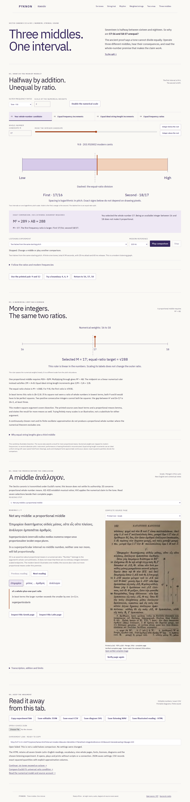
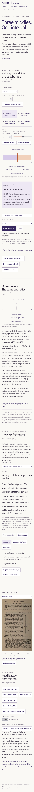

# Three middles: direct review

Reviewed 2026-10-26 in Los Angeles; machine receipts use 2026-10-27 UTC.
The [model account](halves-model.md) identifies the primary source and the
modern assumptions. Publication is a separate claim recorded below once checked.

## Try the actual work

Open [Three middles](https://antonsoo.github.io/pyknon/halves.html).
The opening integer candidate 17 gives 17/16 and 18/17. **289 > 288** decides
which interval is larger. The additive frequency middle keeps that result;
the ideal equal-string-length middle is 288/17 and reverses it. The geometric
middle 12√2 makes both frequency ratios 3√2/4. Its oscillator is a finite
approximation, outside the whole-number premise of the source assertion.

Double the numerical scale. The candidate becomes 34 between 32 and 36,
with the same ratios. Try the integers below and above the root. Then choose
**4,6,9**: an integer proportional mean exists because the 9/4 outer ratio is
outside the superparticular premise. **Use the printed pair** selects 9 and 12,
matching III's figure rather than pretending the source illustrates 16–18.

Seven complete selected Greek/Latin/English readings and nineteen contextual
word notes accompany nine complete pages. The phrase **ἀνάλογον** means
“in proportion”; omitting it would turn the theorem into a false assertion
about every ordinary integer between scaled endpoints.



## Evidence from operation

| Claim               | Observed evidence                                                                                                                                                                                                                                                         |
| ------------------- | ------------------------------------------------------------------------------------------------------------------------------------------------------------------------------------------------------------------------------------------------------------------------- |
| Exact comparisons   | independent Python integers/Fraction/isqrt checked 83,360 cases, 331,640 scheduled tones; all 64 superparticular families at all 256 allowed scales, plus named ratios, references and sound modes                                                                        |
| Source identity     | original PDF identified by length/hash; Poppler 24.02.0 reproduced all nine complete JPEGs byte for byte; font/license identities verified separately                                                                                                                     |
| Current browser     | Chromium 153.0.8010.12 and Firefox 155.0, each at 1440 and 375 px; all methods, controls, readings, word notes, nine displayed blob identities, keyboard zoom/pan, actual import/export and explicit share link                                                           |
| Audible realization | live finite oscillators, stop and held-resume cancellation operated; sixteen actual native WAVs measured independently by zero crossings and complete PCM phase/envelope fits at predicted frequencies                                                                    |
| Portable file       | four script-disabled, browser-offline native HTML contexts; nine original image identities, three fonts, full MIT/OFL notices, seven complete trilingual passages, nineteen complete word notes; all four native downloads matched embedded bytes                         |
| Printed reading     | twenty pages from native HTML; all readings and word notes searchable and complete; nine original JPEGs recoverable byte for byte; 2,389 words within 25-point margins                                                                                                    |
| Offline lesson      | current controller matched this edition and its complete 91-entry cache; local origin refused real HTTP requests, browser networking was disabled, then settings, source verification and an illustrated reading save worked                                              |
| Actual upgrade      | authentic previous seven-room gh-pages worker; both browsers at 375 px with held or substituted new source; old lesson worked during real origin outage, new lesson never claimed early readiness; eight rooms and new save worked after takeover with origin unavailable |
| Failures            | both browsers: late earlier image ignored, wrong HTTP-200 image rejected by viewer and export, valid recovery, delayed save captured original settings, delayed JSON read did not overwrite newer settings                                                                |
| Access              | zero axe violations, page errors or CSP errors in the four complete lesson journeys; no page-level horizontal overflow                                                                                                                                                    |

The diagram and ordinary exact text have distinct phone layouts. The native
reading uses the same responsive plates, without needing JavaScript.



## Reproduce

Use Node 24, Python 3 and installed Playwright Chromium/Firefox. The PCM checker
needs NumPy; the artifact checker needs Poppler tools. From a clean checkout:

```sh
npm ci
npm run check
npm run verify:halves
npm run test:halves -- /tmp/pyknon-halves-review
python3 scripts/halves-wave-oracle.py /tmp/pyknon-halves-review/review.json
python3 scripts/halves-artifacts.py /tmp/pyknon-halves-review
```

The browser runner serves its own production origin. Supply an HTTPS base as
the third argument to replay against the published site. That replay disables
browser networking; it does not stop a remote server. For the fault runner,
serve `dist/` using `npm run preview`, then pass its base URL to
`scripts/halves-integrity.mjs`. The upgrade runner takes an untouched previously
published seven-room directory and an output JSON path. Reproduction of source
images takes the identified PDF path as `scripts/halves-sources.py`'s argument.

Retained receipts: [browser](halves-review/local-browser.json),
[PCM](halves-review/audio.json), [portable/print](halves-review/artifacts.json),
[source reproduction](halves-review/sources.json),
[upgrade](halves-review/upgrade.json), [faults](halves-review/faults.json).
Actual initial [JSON](../examples/halves/16-17-18.json),
[CSV](../examples/halves/16-17-18.csv) and
[font-embedded SVG](../examples/halves/16-17-18.svg) are retained.

## Limits

The independent numerical checker is not a philological review. English and
word notes are new instructional work. The bench proves/illustrates the one-mean
case; III and XVI also assert a result about more means. Fixed wave speed,
modern reference hertz and synthetic sine sound are disclosed assumptions.
Physical speakers, listener discrimination, historical instrumental timbre,
physical printing and tagged PDF accessibility were not established. The PCM
checks account for finite oscillator parameters and bounded automation edges;
they do not claim sample-identical audio across browsers.

Source, local build, fresh clone, hosted bytes, public operation and remote
workflow execution are separate evidence. No remote CI pass is inferred here.
