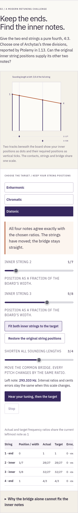

# Public helikon edition

The ten-room edition is available at the [canonical workshop](https://antonsoo.github.io/pyknon/helikon.html).
This record follows the earlier [local review](helikon-review.md); its public
claims were checked separately on 27 October 2026.

| Surface            | Observed identity or result                                                                        |
| ------------------ | -------------------------------------------------------------------------------------------------- |
| Published source   | `d141e0dca839ac627fb50af52031283844a49f2e`                                                         |
| Pages branch       | `2e96ba4be6e817e407e669137d53d8f8bd2618d5`                                                         |
| Production edition | `a7c5e558214183678faec9d09ece8a4ec8a4dbeaad1ad809ffcc32863c109a46`                                 |
| Canonical files    | All 115 current build files match, plus the directory entry before and after inventory             |
| Browser operation  | Chromium and Firefox, 1440 px and 375 px; four complete journeys                                   |
| Offline            | Current controller and complete 114-file cache, disconnected reload, all ten rooms, saved reading  |
| Actual exports     | JSON, CSV, SVG, WAV and illustrated HTML; script-disabled reopening and native downloads           |
| Sound files        | 20 WAVs, 136 independently measured tones; generated PCM, not speaker output                       |
| PDF                | 21 pages, all 78 language fields and eight source captions; untagged, physical printing unverified |
| Remote CI          | Run `40578395885` reports failure; its `check` job has no executed steps                           |
| Pages service      | Latest build reported `built` for the Pages commit above                                           |

The source and Pages pushes were explicitly authorized by the owner after the
local handoff. The Pages update is an ordinary fast-forward commit preserving
its branch history. No release tag or registry version is implied.

[Complete file identities](helikon-hosted-files.json),
[browser/cache receipts](helikon-hosted-browser.json), and
[actual export audit](helikon-hosted-artifacts.json) retain the public results.
The file inventory uses canonical URLs without cache-busting queries. Its
scope is the current build; it does not enumerate unrelated historical URLs.




These actual public screenshots were inspected. At phone width the numerical
table remains inside a labelled scrolling region. Its offscreen columns remain
available by horizontal scrolling. Source-language notes have not received an
independent philological review.

## Replay

```sh
npm run test:helikon -- https://antonsoo.github.io/pyknon/ /tmp/helikon-public
python3 scripts/helikon-artifacts.py /tmp/helikon-public
node scripts/rhythm-publication.mjs https://antonsoo.github.io/pyknon/ d141e0dca839ac627fb50af52031283844a49f2e 2e96ba4be6e817e407e669137d53d8f8bd2618d5 /tmp/helikon-files.json
```

Run the inventory from the matching reviewed build. A later source checkout can
legitimately produce a different edition. The browser script operates the
actual public lesson and reads back its matching service-worker inventory;
the artifact auditor checks the actual saved files.

Officina's separately reviewed public path is
[search → workshop → pinned review](https://github.com/antonsoo/officina/blob/c1bfe3b88b6d735cdf4b37e6c548505477601c1a/studies/helikon-discovery/README.md).
The subsequent catalogue publication receipts live in its same study directory.
