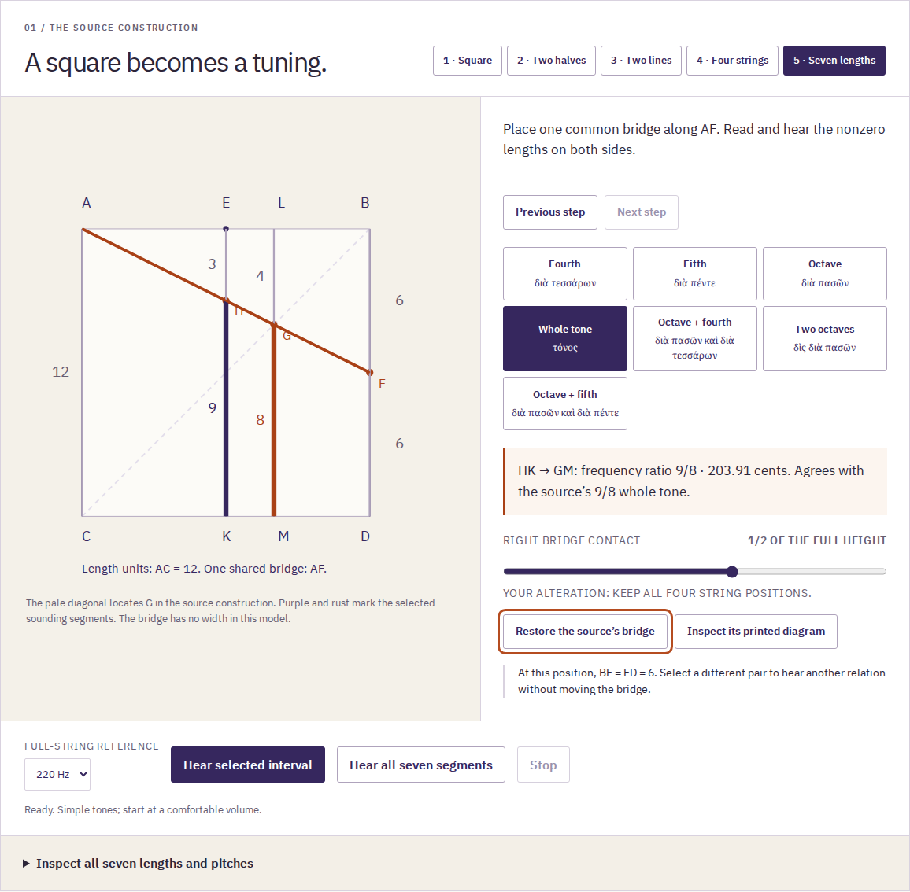
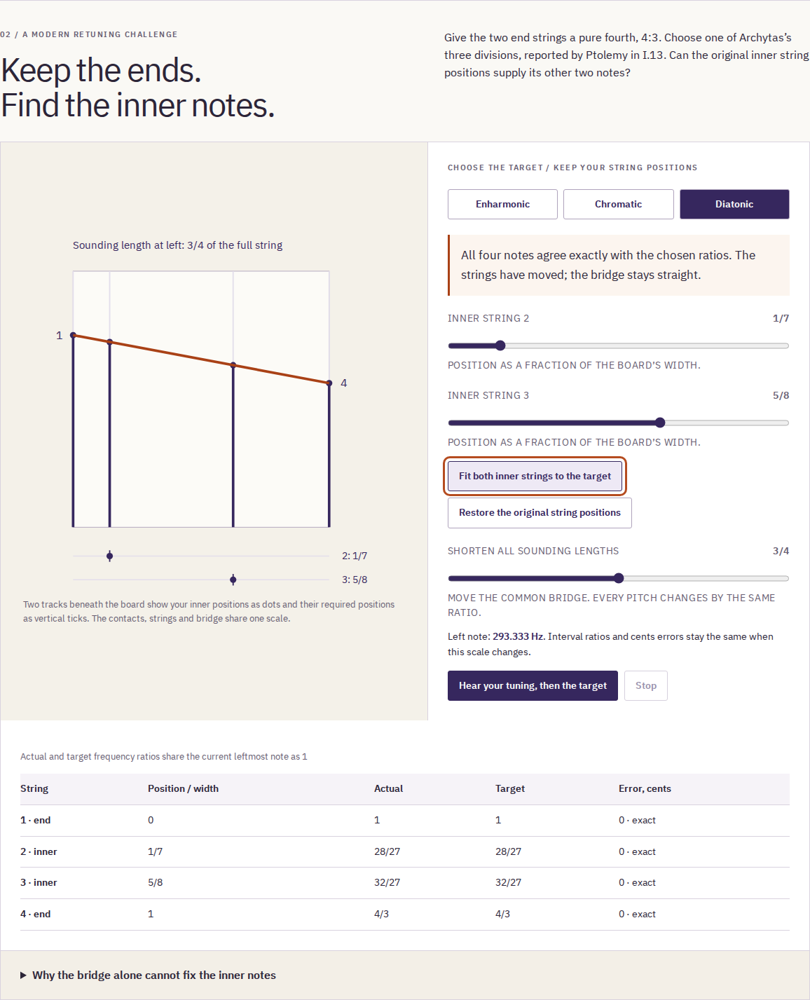

# Direct review of the helikon workshop

The new `/pyknon/helikon.html` room makes Ptolemy’s four-string geometry
operable, then asks what must move when its end notes stay fixed and its inner
target notes change. The first board follows _Harmonics_ II.2; the fourth-span
retuning exercise is a modern reduction of the movable-string principle.
The full extended source construction stays visible in its original pages.

Reviewed locally on 2026-10-27. Runtime source is contained in
`b02b773` and its ancestors. The complete production edition is
`a7c5e558214183678faec9d09ece8a4ec8a4dbeaad1ad809ffcc32863c109a46`.
No push, tag, deployment, public-byte comparison or public browser verification
was performed for this addition. The shared house standards reserve publication
for the coordinator. Existing public-room records concern earlier editions.

## Try the actual work

Run `npm ci`, then `npm run dev`, and choose **Helikon** in the root navigation.
The normal address is `http://127.0.0.1:4329/pyknon/helikon.html`.
For the offline edition, stop dev, run `npm run build`, then `npm run preview`.
The build output is `dist/` and includes all ten rooms.
1. Choose the five construction steps. G comes from intersecting two lines;
   it is not the centre of the square. The source’s seven sounding segments
   contain six different lengths because BF and FD are both 6.
2. Select **Whole tone**: lengths 9 and 8 give a 9/8 frequency ratio.
   Press **Hear selected interval**. Choose fourth, fifth, octave or one of
   the compound relations without moving the bridge.
3. Give **Right bridge contact** one right-arrow step. Its contact becomes
   13/24 of the full height; the selected whole-tone pair becomes **105/92**.
   Restore the source’s bridge. Its contact labels and construction diagonal
   distinguish the source from the alteration.
4. Keep the original inner string positions in the retuning bench. Its end
   notes agree with a fourth-span target, but its two inner notes do not.
   Shorten all sounding lengths: the pitches rise; the interval errors stay.
5. Fit the enharmonic target. The strings move to **1/7** and **1/4** of the
   width. Change to chromatic while keeping those positions: one inner note
   ceases to agree. Fit again at **4/9**; diatonic requires **5/8** instead.
6. Read the six Greek/Latin/English selections and their twelve word notes.
   Inspect the complete printed page for each. The Greek-to-Latin letter
   mapping keeps ζ/F and η/G explicit. Enlarge a page and pan with arrow keys.
7. Save the experiment. Reopen its JSON; open the illustrated HTML with
   JavaScript disabled. Its native downloads, both sound comparisons, eight
   whole source images, fonts and full licenses remain available.





[Phone source board](assets/helikon-mobile.png) ·
[Phone retuning bench](assets/helikon-retuning-mobile.png) ·
[Firefox source board](assets/helikon-firefox-1440-source.png) ·
[Native audio in the script-disabled reading](assets/helikon-portable-audio.png).
The screens were inspected directly. All controls remain ordinary keyboard
controls; the numeric tables supplement the small phone drawing. Wide tables
scroll within their labelled, keyboard-focusable region.

## What the retained evidence establishes

| Evidence                      | Observed result                                                                                                                                                                                    | Receipt                                             |
| ----------------------------- | -------------------------------------------------------------------------------------------------------------------------------------------------------------------------------------------------- | --------------------------------------------------- |
| Independent rational geometry | 32 bridge/reference boards, 224 segments and 224 interval relations; 21,105 retuning boards and 84,420 notes                                                                                       | [geometry](helikon-geometry.json)                   |
| Source reproduction           | Eight whole JPEGs reproduced byte for byte from the identified 189,864,593-byte PDF; six font/license assets identified                                                                            | [sources](helikon-sources.json)                     |
| Actual browser journeys       | Chromium and Firefox, 1440 and 375 px; construction, all intervals, three targets, transposition, source zoom/panning, import/share/history, real downloads and offline work                       | [browser](helikon-browser.json)                     |
| Saved artifacts               | Four script-disabled readings; eight identical source JPEGs and three identical fonts per reading, all licenses, native JSON/CSV/SVG/WAV; no automatic remote request                              | [artifacts](helikon-artifacts.json)                 |
| Generated sound               | 20 actual browser/native WAVs, 136 tones; maximum measured frequency deviation below 0.004 cents, against a 0.03-cent tolerance                                                                    | [PCM measurements](helikon-artifacts.json)          |
| Printed reading               | 21-page browser PDF; all 78 complete language fields, eight source captions and 1,961 extracted words within the checked margins                                                                   | [PDF and audit](../examples/helikon-reading.pdf)    |
| Failure and recovery          | Late pages ignored; substituted HTTP 200 page/font refused; export snapshot preserved; late import cannot replace newer choices; Stop cancels delayed audio resume                                 | [integrity](helikon-integrity.json)                 |
| Complete edition              | Actual previous nine-room build to current ten-room build, held and substituted source in both browsers; old work survives actual origin refusal; recovered editions operate all ten rooms offline | [upgrade](helikon-upgrade.json)                     |
| Saved files after upgrade     | Four actual offline HTML readings, eight original pages and five native downloads each, 40 independently measured tones                                                                            | [upgrade artifacts](helikon-upgrade-artifacts.json) |
| Development server            | All ten pages styled in both browsers at both widths; nonce-bearing injected styles; original policies preserved except the matching development nonce                                             | [development](helikon-development.json)             |

The 21,105-board oracle sweeps each independently variable string position at
every target and scale, holding its neighbour at a valid boundary. It also
checks all 21 exact fits. This is not a claim to enumerate every joint pair of
string positions. The oracle intersects lines using Python `Fraction` and
reads the target length numbers independently from the source’s p.63 table.

The browser review reported zero axe violations in its four final page states
and zero page errors. This is a limited automated accessibility observation,
not a complete accessibility certification. All 114 precached files match the
build inventory; `sw.js` is the separate 115th build file. Readiness requires
the matching controlling worker, not just a registration or an HTTP success.

The PCM check measures generated samples, gain, gaps, duration and silent tails.
It does not measure speakers, an ancient instrument, practical finger reach or
a listener’s pitch recognition. The PDF is untagged; physical printing is
unverified. English and language notes have not received independent
philological review. [Source, model and limits](helikon-model.md).

## Reproduce the review

Node 24 or later, Python 3, Poppler, and the Chromium/Firefox binaries used by
Playwright are required. The retained source renderer is Poppler 24.02.0.
Review environment: Node 26.7.0, Linux/WSL2, Playwright 1.63.0; exact browser
binaries are controlled by the installed Playwright package.

```sh
npm ci
npm run check
npm run verify:helikon
npm run verify:helikon-sources -- /path/to/the/identified/wallis.pdf
```

With `npm run preview -- --port 4362` running:

```sh
npm run test:helikon -- http://127.0.0.1:4362/pyknon/ /tmp/pyknon-helikon-review
npm run verify:helikon-files -- /tmp/pyknon-helikon-review
npm run test:helikon-integrity -- http://127.0.0.1:4362/pyknon/ /tmp/pyknon-helikon-integrity
```

The reviewer saves actual files and verifies native reopening with scripts
disabled. Its driver polls native readiness directly: Firefox suppresses
page-level Promise continuations in a script-disabled document, which must
not be confused with a broken reading. The saved document contains no script.
Do not rebuild the served `dist/` during this review.

With `npm run dev -- --port 4364` running:

```sh
npm run test:helikon-development -- http://127.0.0.1:4364/pyknon/ /tmp/pyknon-helikon-development
```

To reproduce the actual predecessor, create a separate checkout of
`ba97e9c0f805eb8aa737b6c7d9a354b6154e9ff6`, run its `npm ci` and `npm run build`,
and supply its `dist/` to the upgrade reviewer:

```sh
npm run test:helikon-upgrade -- /path/to/previous/dist dist /tmp/pyknon-helikon-upgrade/review.json
npm run verify:helikon-files -- /tmp/pyknon-helikon-upgrade --upgrade
```

The CI workflow contains these commands. Remote CI was not run or observed.
The earlier notation upgrade is replaced as the current workflow gate by the
authentic nine-to-ten-room upgrade, with an actual predecessor build.

## Defects corrected during direct use

The saved reading’s uninterrupted source checksum widened a 375 px document.
Its checksum now wraps, and the retained script-disabled phone files stay
within the viewport. The exact checksum text remains intact.

Vite’s injected development styles were blocked by the strict policies on
rooms importing their CSS from JavaScript. A development-only style nonce now
matches [Vite’s documented nonce mechanism](https://vite.dev/config/shared-options.html#html-cspnonce)
and the installed client implementation. Existing source policies permitting
inline styles retain those policies. Production keeps each original HTML
policy and contains no development nonce. No `unsafe-inline` permission is
added to the production helikon page.

## Actual files you can retain

[Editable experiment](../examples/helikon-experiment.json) ·
[Exact measurements](../examples/helikon-measurements.csv) ·
[Font-embedded diagram](../examples/helikon-diagrams.svg) ·
[Retuning WAV](../examples/helikon-retuning.wav) ·
[Selected interval WAV](../examples/helikon-interval.wav) ·
[21-page PDF](../examples/helikon-reading.pdf) ·
[Complete HTML, gzip](../examples/helikon-reading.html.gz).

Decompress the HTML before opening it:

```sh
gzip -dc examples/helikon-reading.html.gz > /tmp/pyknon-helikon-reading.html
```

The artifact receipt identifies the exact original browser file, rather than
claiming that a handwritten example or separately rebuilt document is the
browser’s download. The [clean-install/build check](helikon-clean-build.json) and [publication handoff](helikon-handoff.md) are retained separately.
